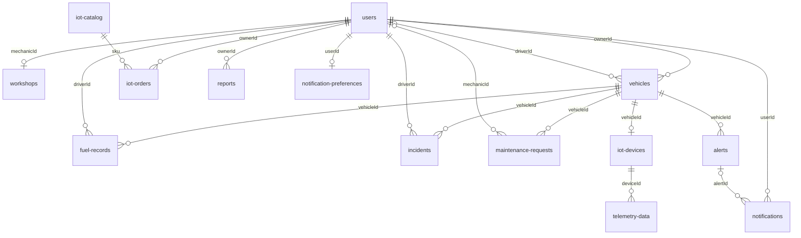

# Fake API de Flotix (`jsonserver/db.json`)

## 1. Propósito

`db.json` es la base de datos de la **Fake API** de Flotix. Con [json-server](https://github.com/typicode/json-server) expone cada colección como un recurso REST, de modo que el frontend (Web Application y Landing Page) pueda desarrollarse y probarse sin depender del backend real (.NET + PostgreSQL).

| Elemento | Valor |
|---|---|
| Carpeta | `jsonserver/` |
| Datos | `jsonserver/db.json` |
| Reescritura de rutas | `jsonserver/routes.json` → `/api/v1/*` se reescribe a `/$1` |
| Arranque | `jsonserver/init.sh` → `json-server --port 6767 --watch db.json --routes routes.json` |
| URL base | `http://localhost:6767/api/v1` |

> `--routes` y `--watch` corresponden a **json-server 0.17.x** (`npm i -g json-server@0.17.4`). La versión 1.x ya no soporta `routes.json`.

### Cómo ejecutarla

```bash
cd jsonserver
./init.sh
# GET http://localhost:6767/api/v1/vehicles
```

Con `--watch`, los `POST`, `PUT`, `PATCH` y `DELETE` **modifican `db.json`**. Para volver a los datos originales usa `git checkout -- jsonserver/db.json`.

## 2. Convenciones del dataset

- **IDs:** texto con prefijo por recurso (`u-`, `w-`, `v-`, `f-`, `i-`, `m-`, `d-`, `t-`, `al-`, `n-`, `o-`, `r-`, `np-`). Los usuarios demo tienen IDs descriptivos (`u-owner-demo`, `u-driver-2`, `u-mechanic-3`). Al crear registros, envía siempre el `id` desde el front con el prefijo del recurso (por ejemplo `v-13`).
- **Fechas:** `createdAt` y los campos de fecha-hora usan ISO 8601 en UTC (`2026-10-23T08:10:00.000Z`). Los campos de solo fecha (`date`, `orderDate`, `licenseExpiry`) usan `YYYY-MM-DD`.
- **Moneda:** soles (S/) como número decimal.
- **Estados y tipos:** en español, tal como se muestran en la interfaz (`Disponible`, `En reparación`, `Pendiente de pago`, etc.).
- **Sin integridad referencial:** json-server no valida claves foráneas, estados ni campos obligatorios. Esas reglas las debe aplicar el front o el backend real.
- **Sin cálculos:** la Fake API no devuelve valores derivados (rendimiento km/L, consumo anómalo, resúmenes, paneles). El front los calcula con los datos y con `fleet-preferences`.

## 3. Resumen de colecciones

| Colección | Endpoint | Registros | Descripción |
|---|---|---:|---|
| `users` | `/api/v1/users` | 18 | Dueños (2), conductores (6) y mecánicos (10) |
| `workshops` | `/api/v1/workshops` | 10 | Talleres afiliados, uno por mecánico |
| `vehicles` | `/api/v1/vehicles` | 12 | Flota de los dos dueños |
| `fuel-records` | `/api/v1/fuel-records` | 31 | Recargas de combustible |
| `incidents` | `/api/v1/incidents` | 10 | Incidencias reportadas por conductores |
| `maintenance-requests` | `/api/v1/maintenance-requests` | 11 | Solicitudes de mantenimiento |
| `iot-devices` | `/api/v1/iot-devices` | 10 | Dispositivos GPS vinculados a vehículos |
| `telemetry-data` | `/api/v1/telemetry-data` | 28 | Lecturas de telemetría |
| `alerts` | `/api/v1/alerts` | 10 | Alertas de velocidad y mantenimiento |
| `notifications` | `/api/v1/notifications` | 12 | Notificaciones a usuarios |
| `iot-catalog` | `/api/v1/iot-catalog` | 10 | Catálogo de dispositivos IoT |
| `iot-orders` | `/api/v1/iot-orders` | 10 | Pedidos de dispositivos |
| `reports` | `/api/v1/reports` | 10 | Reportes generados |
| `notification-preferences` | `/api/v1/notification-preferences` | 18 | Preferencias de notificación por usuario |
| `fleet-preferences` | `/api/v1/fleet-preferences` | 1 (objeto) | Parámetros de reglas de negocio |

## 4. Modelo de datos y relaciones



## 5. Colecciones

### 5.1 `users`

| Campo | Tipo | Descripción |
|---|---|---|
| `id` | string | Identificador (`u-owner-demo`, `u-driver-2`, `u-mechanic-3`) |
| `createdAt` | string (ISO) | Fecha de creación |
| `name` | string | Nombre completo |
| `email` | string | Correo (único) |
| `passwordHash` | string | Contraseña. **En la Fake API es texto plano `"1234"`**; el backend real guarda un hash |
| `role` | string | `Owner`, `Driver` o `Mechanic` |
| `licenseNumber` | string \| null | Licencia (solo `Driver`) |
| `licenseExpiry` | string \| null | Vencimiento de la licencia, `YYYY-MM-DD` (solo `Driver`) |
| `companyName` | string \| null | Empresa (solo `Owner`) |
| `workshopName` | string \| null | Nombre del taller (solo `Mechanic`) |

Cuentas demo (contraseña `1234`):

| Rol | Correo |
|---|---|
| Owner (flota de 8 vehículos) | `owner@flotix.pe` |
| Owner (flota de 4 vehículos) | `carla.mendoza@andinalogistica.pe` |
| Driver | `driver@flotix.pe` |
| Mechanic | `mechanic@flotix.pe` |

La Fake API no tiene endpoint de login. Para simularlo: `GET /users?email=owner@flotix.pe&passwordHash=1234` y validar que el arreglo no esté vacío.

### 5.2 `workshops`

| Campo | Tipo | Descripción |
|---|---|---|
| `id` | string | `w-1` … `w-10` |
| `createdAt` | string (ISO) | Fecha de creación |
| `mechanicId` | string | Usuario `Mechanic` dueño del taller (`users.id`) |
| `city` | string | Ciudad (todos en `Lima`) |
| `district` | string | Distrito |
| `address` | string | Dirección |
| `phone` | string | Teléfono |
| `rating` | number | Calificación (4.2 a 4.9) |
| `tags` | string[] | Especialidades (`Frenos`, `Motor diésel`, `Eléctrico`, …) |

El nombre del taller no está en esta colección: se obtiene de `users.workshopName` mediante `mechanicId`.

### 5.3 `vehicles`

| Campo | Tipo | Descripción |
|---|---|---|
| `id` | string | `v-1` … `v-12` |
| `createdAt` | string (ISO) | Fecha de creación |
| `ownerId` | string | Dueño (`users.id`) |
| `driverId` | string \| null | Conductor asignado; `null` = "Sin asignar" |
| `plate` | string | Placa (única) |
| `vehicleType` | string | `Automóvil`, `Camioneta`, `Mototaxi`, `Camión de carga`, `Van de pasajeros` |
| `currentMileage` | number | Kilometraje actual |
| `status` | string | `Disponible`, `En mantenimiento`, `Inactivo` |

### 5.4 `fuel-records`

| Campo | Tipo | Descripción |
|---|---|---|
| `id` | string | `f-1` … `f-31` |
| `createdAt` | string (ISO) | Fecha de creación |
| `vehicleId` | string | Vehículo (`vehicles.id`) |
| `driverId` | string | Conductor que registró la recarga (`users.id`) |
| `liters` | number | Litros cargados |
| `totalCost` | number | Costo total (S/) |
| `mileageAtRefuel` | number | Kilometraje del odómetro en la recarga |
| `date` | string | Fecha de la recarga, `YYYY-MM-DD` |

Valores derivados (calculados por el front): rendimiento (km/L) = (`mileageAtRefuel` − kilometraje de la recarga anterior) ÷ `liters`; la primera recarga de cada vehículo no tiene rendimiento. Una recarga es **anómala** si su rendimiento es menor al `100 − fuelAnomalyDropPct` % (70 %) del promedio histórico del vehículo.

### 5.5 `incidents`

| Campo | Tipo | Descripción |
|---|---|---|
| `id` | string | `i-1` … `i-10` |
| `createdAt` | string (ISO) | Fecha de creación |
| `vehicleId` | string | Vehículo afectado |
| `driverId` | string | Conductor que reporta |
| `description` | string | Descripción del problema |
| `status` | string | `Abierto` → `En revisión` → `Resuelto` |
| `reportedAt` | string (ISO) | Fecha del reporte |

### 5.6 `maintenance-requests`

| Campo | Tipo | Descripción |
|---|---|---|
| `id` | string | `m-1` … `m-11` |
| `createdAt` | string (ISO) | Fecha de la solicitud |
| `vehicleId` | string | Vehículo |
| `mechanicId` | string \| null | Mecánico/taller asignado; `null` mientras no se elige taller |
| `faultDescription` | string | Descripción de la falla o servicio |
| `estimatedCost` | number | Costo estimado (S/); `0` hasta que haya cotización |
| `status` | string | `Pendiente` → `Presupuestado` → `Aprobado` / `Rechazado` → `En reparación` → `Completado` |

Regla de sincronización con la flota: un vehículo con solicitud `En reparación` debe estar `En mantenimiento`; al pasar a `Completado` vuelve a `Disponible`. Una solicitud `Rechazado` no cuenta como abierta.

### 5.7 `iot-devices`

| Campo | Tipo | Descripción |
|---|---|---|
| `id` | string | `d-1` … `d-10` |
| `createdAt` | string (ISO) | Fecha de vinculación |
| `vehicleId` | string | Vehículo equipado (máximo un dispositivo por vehículo) |
| `serialNumber` | string | Serie única (`FLX-GPS-0001`) |
| `connectionStatus` | string | `Conectado` o `Desconectado` |

### 5.8 `telemetry-data`

| Campo | Tipo | Descripción |
|---|---|---|
| `id` | string | `t-1` … `t-28` |
| `createdAt` | string (ISO) | Fecha de recepción |
| `deviceId` | string | Dispositivo emisor (`iot-devices.id`) |
| `latitude` | number | Latitud (−90 a 90) |
| `longitude` | number | Longitud (−180 a 180) |
| `speed` | number | Velocidad en km/h |
| `timestamp` | string (ISO) | Momento de la lectura |

La posición actual de un vehículo es la lectura más reciente de su dispositivo.

### 5.9 `alerts`

| Campo | Tipo | Descripción |
|---|---|---|
| `id` | string | `al-1` … `al-10` |
| `createdAt` | string (ISO) | Fecha de creación |
| `vehicleId` | string | Vehículo que dispara la alerta |
| `alertType` | string | Texto libre con el valor entre paréntesis: `Exceso de velocidad (104 km/h)`, `Mantenimiento próximo (90% de kilometraje)` |
| `activatedAt` | string (ISO) | Momento de activación |

### 5.10 `notifications`

| Campo | Tipo | Descripción |
|---|---|---|
| `id` | string | `n-1` … `n-12` |
| `createdAt` | string (ISO) | Fecha de creación |
| `userId` | string | Destinatario (dueño del vehículo) |
| `alertId` | string \| null | Alerta de origen; `null` para notificaciones de incidencias |
| `message` | string | Texto mostrado al usuario |
| `isRead` | boolean | Estado de lectura |
| `sentAt` | string (ISO) | Fecha de envío |

### 5.11 `iot-catalog`

| Campo | Tipo | Descripción |
|---|---|---|
| `id` | string | Igual al `sku` (`gps`, `odometer`, `fuel-sensor`, …) |
| `sku` | string | Código del producto, referenciado por `iot-orders.sku` |
| `name` | string | Nombre comercial |
| `unitPrice` | number | Precio unitario (S/) |
| `iconName` | string | Ícono de la UI (`pin`, `signal`, `fuel`, `chip`, `camera`, `gear`, `shield`, `bell`, `chart`, `users`) |

Productos principales de la propuesta de valor: Rastreador GPS Flotix (S/ 149.90), Odómetro digital Flotix (S/ 89.90) y Sensor de combustible Flotix (S/ 119.90). El catálogo incluye otros 7 dispositivos (OBD-II, cámara de cabina, sensor de llantas, inmovilizador, botón de pánico, sensor de temperatura y lector de conductor).

### 5.12 `iot-orders`

| Campo | Tipo | Descripción |
|---|---|---|
| `id` | string | `o-1` … `o-10` |
| `createdAt` | string (ISO) | Fecha de creación |
| `ownerId` | string | Dueño que compra |
| `sku` | string | Producto (`iot-catalog.sku`) |
| `deviceQuantity` | number | Cantidad (entero > 0) |
| `totalAmount` | number | `unitPrice` × `deviceQuantity` |
| `status` | string | `Pendiente de pago` → `En preparación` → `Entregado`; también `Cancelado` |
| `orderDate` | string | Fecha del pedido, `YYYY-MM-DD` |

### 5.13 `reports`

| Campo | Tipo | Descripción |
|---|---|---|
| `id` | string | `r-1` … `r-10` |
| `createdAt` | string (ISO) | Fecha de creación |
| `ownerId` | string | Dueño que genera el reporte |
| `reportType` | string | `Reporte de rendimiento de flota`, `Reporte de consumo de combustible`, `Reporte de costos de mantenimiento`, `Reporte de incidencias` |
| `generatedAt` | string (ISO) | Fecha de generación |
| `filterParams` | object | Filtros usados: `from`, `to`, `vehicleId`, `status` (puede ser `{}`) |

### 5.14 `notification-preferences`

| Campo | Tipo | Descripción |
|---|---|---|
| `id` | string | `np-1` … `np-18` |
| `userId` | string | Usuario (uno por usuario) |
| `maintenance` | boolean | Recibir avisos de mantenimiento |
| `speed` | boolean | Recibir alertas de velocidad |
| `incidents` | boolean | Recibir avisos de incidencias |

### 5.15 `fleet-preferences` (objeto único)

| Campo | Valor | Uso |
|---|---|---|
| `speedLimitKmh` | `90` | Una lectura con velocidad mayor genera alerta de exceso de velocidad |
| `maintenanceIntervalKm` | `10000` | Intervalo de revisión; las alertas "Mantenimiento próximo" se calculan como porcentaje de este intervalo |
| `fuelAnomalyDropPct` | `30` | Caída porcentual que marca un consumo anómalo (umbral = 70 % del promedio) |

Al ser un objeto, `GET /fleet-preferences` devuelve el objeto completo y se actualiza con `PUT` o `PATCH`.

## 6. Consultas útiles

```http
# Vehículos de un dueño
GET /api/v1/vehicles?ownerId=u-owner-demo

# Conductores
GET /api/v1/users?role=Driver

# Búsqueda de texto en toda la colección
GET /api/v1/users?q=quispe

# Historial de combustible de un vehículo, más reciente primero
GET /api/v1/fuel-records?vehicleId=v-1&_sort=date&_order=desc

# Incidencias abiertas
GET /api/v1/incidents?status=Abierto

# Solicitudes de un taller por estado
GET /api/v1/maintenance-requests?mechanicId=u-mechanic-2&status=En reparación

# Última lectura de un dispositivo
GET /api/v1/telemetry-data?deviceId=d-1&_sort=timestamp&_order=desc&_limit=1

# Notificaciones sin leer de un usuario
GET /api/v1/notifications?userId=u-owner-demo&isRead=false

# Paginación
GET /api/v1/fuel-records?_page=1&_limit=10

# Incluir el vehículo en cada recarga (la clave foránea debe llamarse <recurso singular>Id)
GET /api/v1/fuel-records?_expand=vehicle

# Marcar una notificación como leída
PATCH /api/v1/notifications/n-2
{ "isRead": true }
```

Limitaciones de `_expand`: solo funciona con claves cuyo nombre corresponde a una colección (`vehicleId` → `vehicles`, `userId` → `users`, `alertId` → `alerts`). No aplica a `ownerId`, `driverId`, `mechanicId` ni `deviceId`; en esos casos hay que hacer una segunda consulta.

## 7. Datos para casos de prueba

| Escenario | Datos |
|---|---|
| Consumo anómalo | `f-25` (v-6, CGH-275): 3.49 km/L frente a un promedio de 5.16 km/L (≈ 68 %) |
| Primera recarga sin rendimiento | `f-1`, `f-5`, `f-8`, `f-11`, `f-14`, `f-17`, `f-20`, `f-23`, `f-26`, `f-29` |
| Vehículos sin recargas (excluidos del comparativo) | `v-7`, `v-11` |
| Exceso de velocidad (> 90 km/h) | `t-2` (d-1, 104), `t-13` (d-5, 97), `t-16` (d-6, 101), `t-19` (d-7, 112), `t-22` (d-8, 95), con alertas `al-2` a `al-6` |
| Dispositivos desconectados | `d-4` (v-5) y `d-9` (v-11), con lecturas de velocidad 0 del 2026-10-20 |
| Solicitudes en cada estado | Pendiente (`m-2`, `m-9`, sin taller), Presupuestado (`m-5`, `m-11`), Aprobado (`m-6`), En reparación (`m-1`, `m-3`, `m-4`), Completado (`m-7`, `m-10`), Rechazado (`m-8`) |
| Incidencias en cada estado | Abierto (`i-1`, `i-3`, `i-9`), En revisión (`i-2`, `i-4`, `i-7`), Resuelto (`i-5`, `i-6`, `i-8`, `i-10`) |
| Pedidos en cada estado | Pendiente de pago (`o-8`), En preparación (`o-3`, `o-7`, `o-10`), Entregado (`o-1`, `o-2`, `o-4`, `o-5`, `o-9`), Cancelado (`o-6`) |
| Alertas de mantenimiento próximo | `al-1`, `al-7`, `al-8`, `al-9`, `al-10` (90 % a 97 % del intervalo de 10 000 km) |
| Vehículo inactivo sin conductor | `v-7` |

### Particularidades del dataset

- El conductor `u-driver-demo` figura asignado a dos vehículos (`v-1` y `v-3`).
- Los registros de combustible de `v-2`, `v-10` y `v-12` tienen un `driverId` aunque el vehículo hoy no tiene conductor asignado (son históricos).
- Solo las incidencias `i-1` e `i-9` tienen notificación (`n-11`, `n-12`); el resto de incidencias abiertas no.
- Las alertas `al-5` y `al-6` están fechadas el 2026-10-22, mientras que sus lecturas de telemetría (`t-22`, `t-16`) son del 2026-10-23.
- `maintenance-requests` no tiene fecha de solicitud propia: se usa `createdAt`.

## 8. Equivalencia con la REST API real (.NET)

La Fake API usa nombres y formatos distintos a los del backend. Al migrar el front, estos son los cambios:

| Colección | Fake API | REST API real |
|---|---|---|
| Todas | `id` de texto con prefijo (`v-1`) | `id` tipo GUID |
| `users` | `role` | `roleType` |
| `users` | `licenseExpiry` | `licenseExpiration` |
| `users` | `passwordHash` en texto plano, login por consulta | `POST /authentication/sign-in` devuelve JWT |
| `vehicles` | `plate` | `licensePlate` |
| `fuel-records` | `totalCost` | `cost` |
| `fuel-records` | `mileageAtRefuel` | `mileageAtRefill` |
| `fuel-records` | `date` | `recordedDate` |
| `incidents` | `reportedAt` | `reportedDate` |
| `maintenance-requests` | `faultDescription` | `description` |
| `maintenance-requests` | `createdAt` | `requestDate` |
| `iot-devices` | `connectionStatus` (`Conectado` / `Desconectado`) | `isConnected` (boolean) |
| `telemetry-data` | `timestamp` | `recordedAt` |
| `alerts` | `activatedAt` | `triggerDate` |
| `notifications` | `sentAt` | `sentDate` |
| `iot-orders` | `sku` y `deviceQuantity` | `productId` y `quantity` |
| `workshops` | `tags` | `specialties` |
| `reports` | `reportType` con etiquetas en español | `FuelConsumption` / `MaintenanceCost` |
| Valores derivados | Los calcula el front | Los calcula el backend (resúmenes, rendimiento, panel) |